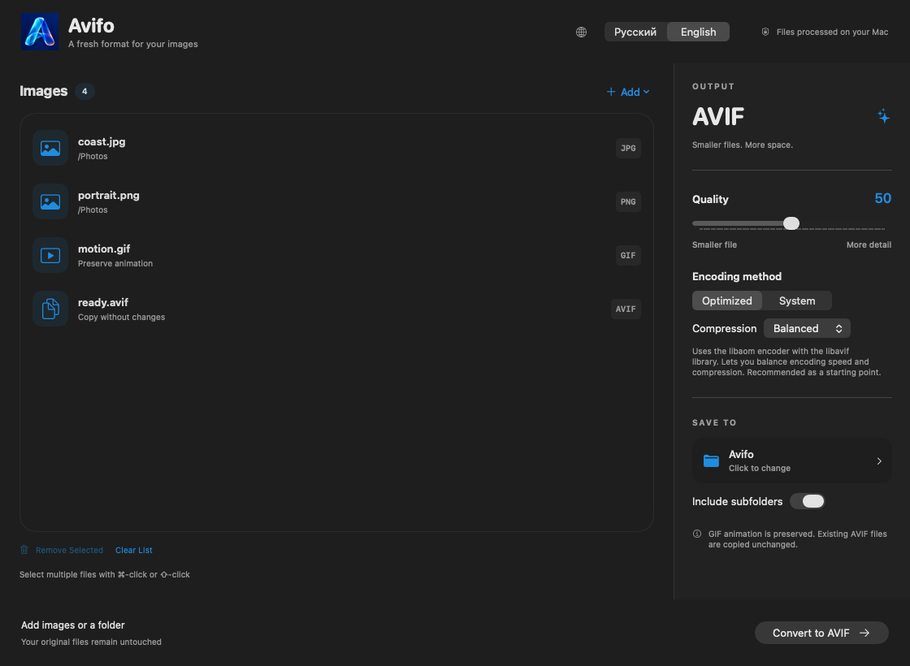

<h1 align="center">Avifo</h1>

A fresh format for your images.

<b>English</b> · <a href="README.ru.md">Русский</a>

<a href="https://github.com/samoyluk/Avifo/releases/latest/download/Avifo.dmg"><b>Download Avifo for Mac</b></a> · <a href="https://avifo.samoyluk.com/en/">Website</a> · <a href="https://github.com/samoyluk/Avifo/releases">Release history</a>

Avifo is a free macOS app for converting images to AVIF. Add a few files or an entire folder, choose the quality, and convert everything on your Mac. Your original files remain untouched.

**Requires macOS 26 or later and Apple Silicon (M-series). Intel Macs are not supported.**

## What you can do

- **Convert JPG, JPEG, PNG and WebP to AVIF** individually or in batches.
- **Convert animated GIFs to animated AVIF** while preserving animation.
- **Process entire folders**, optionally including subfolders.
- **Copy existing AVIF files unchanged** to the output folder.
- **Adjust quality and compression**. Choose Optimized (libaom through libavif) or System (Apple ImageIO) encoding. Optimized mode offers Fast, Balanced and Thorough compression; animated GIFs use libaom.
- **Compare file sizes** after conversion: see the original size, output size and percentage change.
- **Keep your queue organized**: remove selected files or clear the list before conversion. Completed images keep their results when you add more files.
- **Switch between English and Russian** directly in the main window. Light and dark appearance follow your Mac.
- **Install updates from the app** when a new version is available.

## Install

1. Download **Avifo.dmg** using the link above or from the latest release's **Assets** section.
2. Open the disk image and drag **Avifo** into **Applications**.
3. Launch Avifo from Applications.

The current build is not notarized by Apple, so macOS may display a security warning on first launch.

## Get started

1. Drag images into the window, or use **Add** to select files or a folder.
2. Choose an output folder.
3. Set the quality and encoding method. Quality **50** is a useful starting point; check a few results to find the right balance for your images.
4. Click **Convert to AVIF**.

Compression depends on the source image and settings; an output file can occasionally be larger. To convert a completed image again with different settings, remove it from the list and add it again.

## Privacy and pricing

Image conversion happens locally and works offline. Images are not uploaded to a server. Internet access is used to check for updates and load an optional promotional banner. Avifo is free to use, with no account or subscription required.

## Feedback

Found a problem or have an idea? [Open an issue](https://github.com/samoyluk/Avifo/issues). Include your macOS version, Avifo version and steps to reproduce the problem. Only attach images you are comfortable making public.

## About this repository

This repository contains public downloads, documentation and screenshots. The application source code is not published here. Notices and licenses for bundled third-party components are included with the application.
