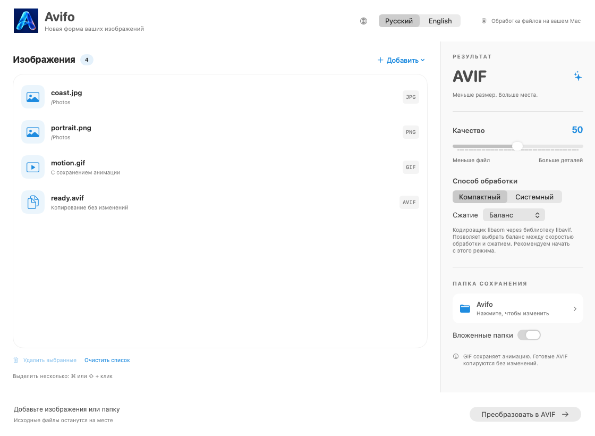

<h1 align="center">Avifo</h1>

Новая форма ваших изображений.

<a href="README.md">English</a> · <b>Русский</b>

<a href="https://github.com/samoyluk/Avifo/releases/latest/download/Avifo.dmg"><b>Скачать Avifo для Mac</b></a> · <a href="https://avifo.samoyluk.com/">Сайт приложения</a> · <a href="https://github.com/samoyluk/Avifo/releases">История версий</a>

Avifo — бесплатное приложение для macOS, которое преобразует изображения в AVIF. Добавьте несколько файлов или целую папку, выберите качество и запустите обработку на своём Mac. Исходные файлы остаются без изменений.

**Требуется macOS 26 или новее и Mac с Apple Silicon (серии M). Mac с процессорами Intel не поддерживаются.**

## Возможности

- **Преобразование JPG, JPEG, PNG и WebP в AVIF** — по одному или сразу несколькими файлами.
- **Преобразование анимированных GIF в анимированные AVIF** с сохранением анимации.
- **Обработка целых папок**, при необходимости — вместе с вложенными папками.
- **Копирование готовых AVIF без изменений** в папку назначения.
- **Настройка качества и сжатия**. Режим «Компактный» использует libaom через libavif, «Системный» — Apple ImageIO. В компактном режиме можно выбрать скорость и тщательность сжатия. Анимированные GIF обрабатываются через libaom.
- **Сравнение размеров файлов**: после обработки видны исходный и итоговый размеры, а также изменение в процентах.
- **Удобный список изображений**: удаление выбранных файлов и очистка списка до начала обработки. Результаты уже обработанных изображений сохраняются при добавлении новых.
- **Русский и английский интерфейс** с переключателем в главном окне. Светлая и тёмная темы следуют настройкам macOS.
- **Установка обновлений прямо из приложения**.

## Установка

1. Скачайте **Avifo.dmg** по ссылке выше или из раздела **Assets** последнего выпуска.
2. Откройте образ диска и перетащите **Avifo** в **Программы (Applications)**.
3. Запустите Avifo из папки «Программы».

Текущая сборка не прошла нотариализацию Apple, поэтому при первом запуске macOS может показать предупреждение безопасности.

## Как пользоваться

1. Перетащите изображения в окно или выберите файлы либо папку через **«Добавить»**.
2. Укажите папку для готовых изображений.
3. Выберите качество и способ обработки. Начните с качества **50** и оцените несколько результатов, чтобы подобрать подходящие настройки.
4. Нажмите **«Преобразовать в AVIF»**.

Степень сжатия зависит от исходного изображения и настроек; иногда итоговый файл может оказаться больше исходного. Чтобы повторно обработать готовое изображение с другими настройками, удалите его из списка и добавьте снова.

## Конфиденциальность и стоимость

Обработка выполняется локально и работает без интернета. Изображения не загружаются на сервер. Интернет используется для проверки обновлений и загрузки рекламного баннера, если он включён. Приложение бесплатное, без регистрации и подписки.

## Обратная связь

Нашли ошибку или хотите предложить улучшение? [Создайте обращение в Issues](https://github.com/samoyluk/Avifo/issues). Укажите версии macOS и Avifo и опишите, как повторить проблему. Прикладывайте только те изображения, которые готовы опубликовать.

## Об этом репозитории

Здесь размещены установщики, документация и скриншоты. Исходный код приложения не опубликован. Лицензии и уведомления сторонних компонентов включены в приложение.
